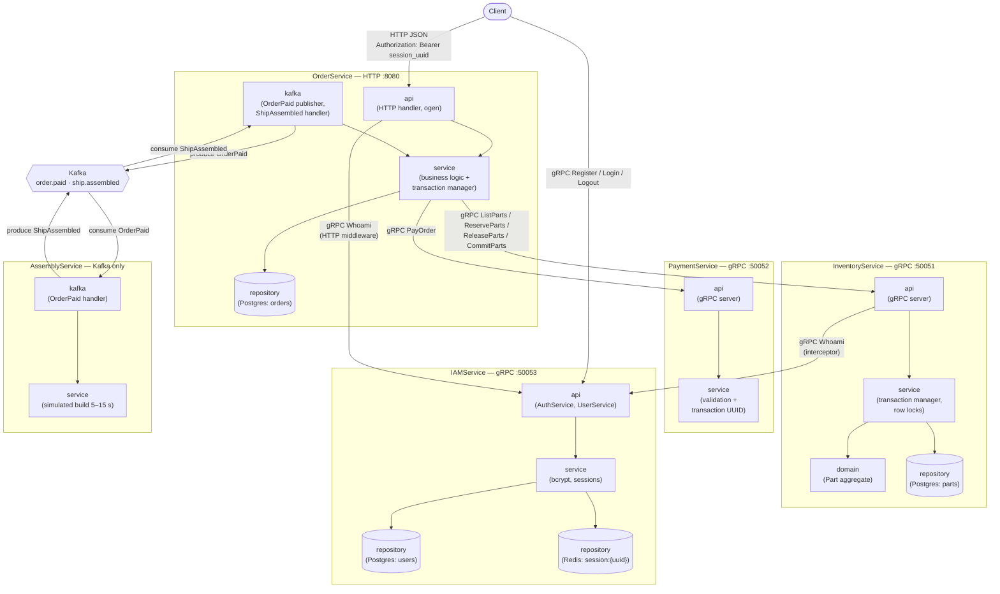
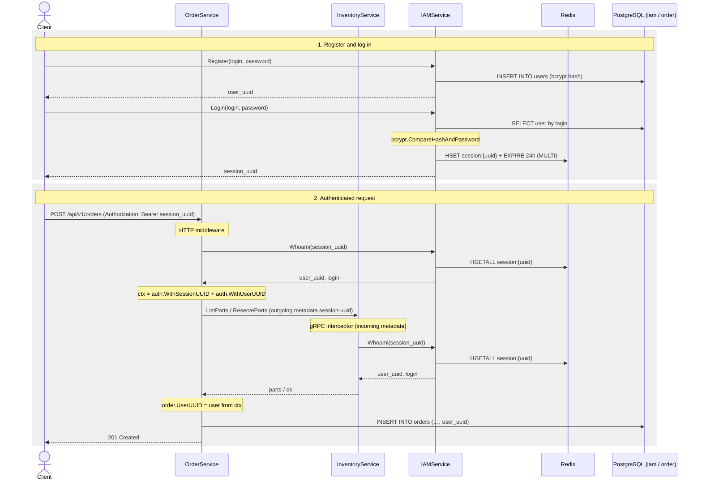
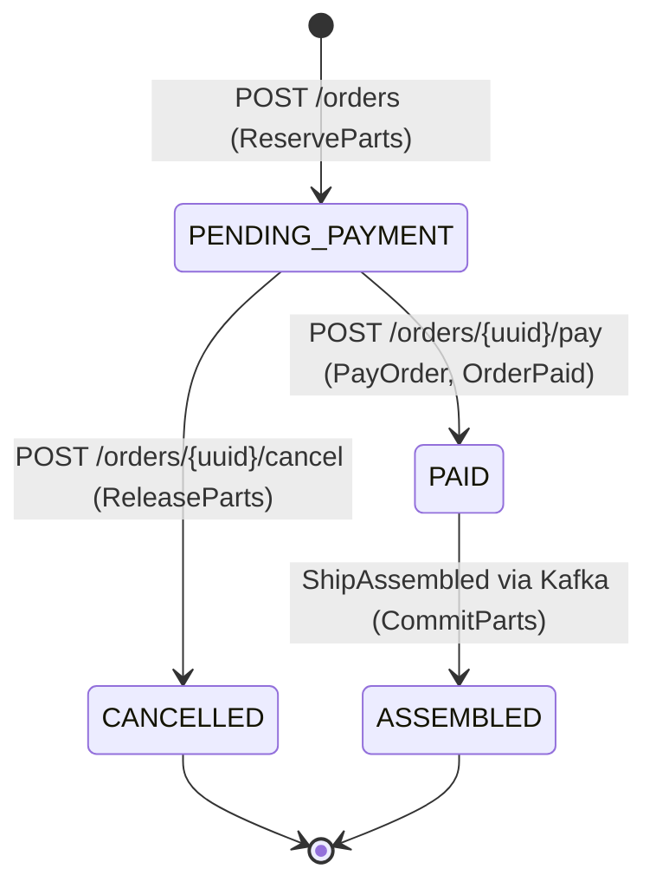
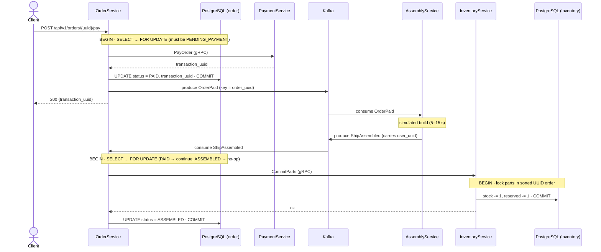
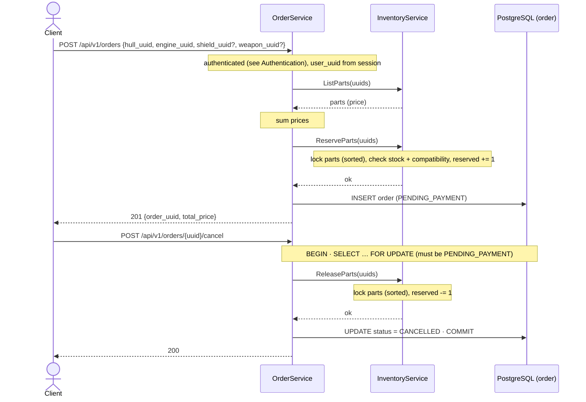
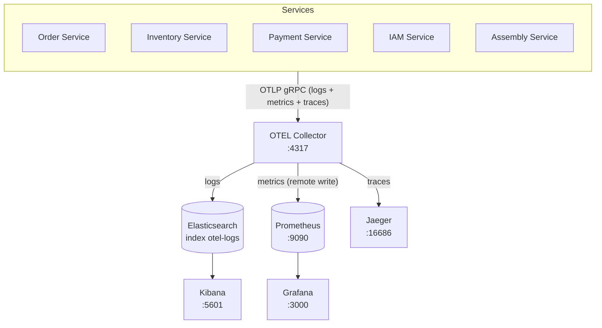
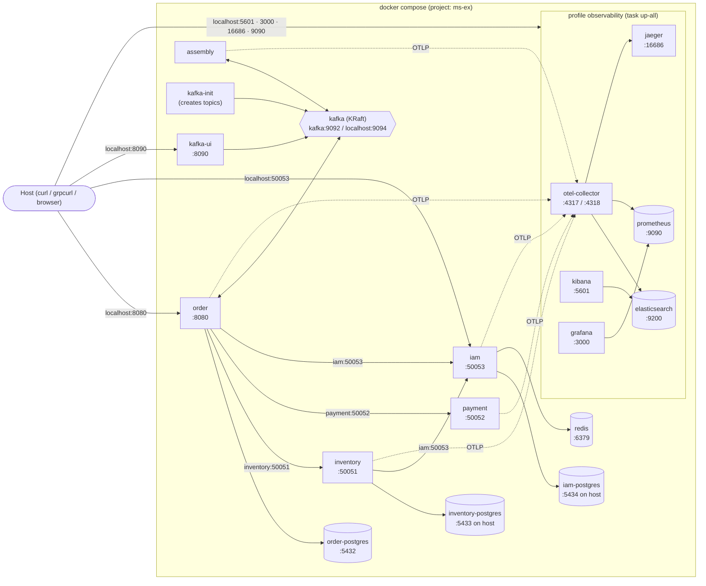

# Architecture

Five Go services build a toy "order a spaceship" system:

- **OrderService** — HTTP API (`:8080`), the only service a client talks to
  directly. Owns orders (PostgreSQL). Kafka producer of `OrderPaid`, consumer
  of `ShipAssembled`.
- **InventoryService** — gRPC (`:50051`), owns the parts catalog, stock and
  reservations (PostgreSQL).
- **PaymentService** — gRPC (`:50052`), processes payments (stateless).
- **AssemblyService** — no inbound port; Kafka consumer of `OrderPaid`,
  simulates building the ship (5–15 s) and produces `ShipAssembled` (stateless).
- **IAMService** — gRPC (`:50053`), identity: users in PostgreSQL (bcrypt
  password hashes), sessions in Redis (hash per session, 24 h TTL).
  `AuthService` (Register, Login, Whoami, Logout) and `UserService` (GetUser).
  Every Order HTTP request and every Inventory gRPC call is authenticated
  against it.

Every service emits telemetry over OTLP to an OpenTelemetry Collector — see
[Observability](#observability).

Contracts and shared plumbing live in the `shared` module: protobuf
(`shared/proto` → `shared/pkg/proto`), the Order OpenAPI spec
(`shared/api/order/v1` → `shared/pkg/openapi`, ogen), the sarama wrapper
`shared/pkg/kafka`, `shared/pkg/auth` (session/user context helpers and the
gRPC client interceptor that forwards the session), and the telemetry setup
`shared/pkg/{logger,metrics,tracing,telemetry}`.

Each service follows the same layering (`<service>/pkg/...`):

- `api` — transport adapter (HTTP handler / gRPC server). Converts wire types
  ⇄ service/domain types, maps errors to status codes. Also hosts the
  authentication edge: Order's HTTP middleware, Inventory's gRPC interceptor.
- `kafka` (Order, Assembly) — the async counterpart of `api`: decodes events,
  calls the service, encodes outgoing events.
- `service` — business logic. Depends only on narrow interfaces it declares
  itself (`Repository`, `InventoryClient`, `TrManager`, `OrderPaidPublisher`,
  …), never on transport or Kafka types.
- `domain` (Inventory) — the `Part` aggregate guards stock/reservation
  invariants (`Reserve`, `Release`, `Commit`).
- `repository` — storage. Order, Inventory and IAM (users) have a
  **PostgreSQL** implementation, IAM sessions a **Redis** one (used in
  `cmd/main.go` and the Compose stack); each also has an in-memory twin used
  only by the self-contained API test suite (`order/tests`).

`internal/app` in each service is the only place that reads env vars and
builds concrete types.

## Component overview

`OrderService.service` is the orchestrator: it is the only place that calls
the other services synchronously for business operations, and it reacts to
the asynchronous `ShipAssembled` event. AssemblyService knows nothing about
orders beyond the event payload. IAM is called only from the authentication
edges (Order middleware, Inventory interceptor) — never from business logic.

## Authentication

Session-based: `Login` returns an opaque `session_uuid`; the client sends it
as `Authorization: Bearer <session_uuid>`. There is no JWT, refresh token,
role or permission model — only "who is this?".

- **Order HTTP middleware** (`order/pkg/api/auth.go`) wraps the whole ogen
  server: missing/malformed header or a session IAM rejects → **401**
  `{"code":401,"message":"unauthorized"}` before any handler runs; IAM
  unreachable → 500. `CreateOrder` takes `user_uuid` from the context — the
  request body no longer has that field.
- **Incoming vs outgoing metadata.** gRPC never propagates a server's
  *incoming* metadata to its own outgoing calls. Order keeps the session on
  `ctx` (`auth.WithSessionUUID`), and its Inventory client's
  `auth.UnaryClientInterceptor()` copies it into **outgoing** metadata
  (`session-uuid`). Inventory's `AuthInterceptor` reads it from **incoming**
  metadata. Payment is not authenticated, so its client has no interceptor.
- **Inventory interceptor** (`inventory/pkg/api/auth.go`) authenticates every
  unary RPC except `CommitParts`, which Order calls from its ShipAssembled
  consumer — there is no user session on that path (see Known limitations).
- **No caching:** both edges call `Whoami` on every request, so `Logout`
  (`DEL session:{uuid}`) takes effect immediately. Sessions don't slide: the
  TTL is set once at login (`IAM_SESSION_TTL`, default 24 h); after it
  expires the user logs in again.
- Unknown login and wrong password both return `Unauthenticated` ("invalid
  login or password"); for an unknown login IAM still runs a bcrypt compare
  against a dummy hash so both cases take the same time.

## Order lifecycle

Pay and Cancel are only allowed from `PENDING_PAYMENT`. Otherwise the order is
left unchanged and the service returns `ErrOrderAlreadyPaid`,
`ErrOrderCancelled` or `ErrOrderAssembled` (HTTP 409 with that message).

Inventory's view of the same lifecycle, per part:

| Order step | `reserved` | `stock_quantity` |
|---|---|---|
| create (`ReserveParts`) | +1 | — |
| cancel (`ReleaseParts`) | −1 | — |
| assembled (`CommitParts`) | −1 | −1 |

## Event flow: pay → assemble

### Events

Defined in `shared/proto/events/v1/events.proto`, sent as protobuf bytes,
keyed by `order_uuid` (one order's events stay ordered on one partition).
Topics are created up front by the `kafka-init` Compose service (3 partitions
each); constants live in `shared/pkg/kafka`.

| Topic | Message | Producer → Consumer (group) | Fields |
|---|---|---|---|
| `order.paid` | `OrderPaid` | Order → Assembly (`assembly-service`) | `event_uuid`, `order_uuid`, `user_uuid`, `payment_method`, `transaction_uuid` |
| `ship.assembled` | `ShipAssembled` | Assembly → Order (`order-service`) | `event_uuid`, `order_uuid`, `user_uuid`, `build_time_sec` |

### Delivery semantics

- **At-least-once.** The consumer marks an offset only after the handler
  returns nil; a returned error makes the session rejoin (1 s backoff) and the
  message is redelivered. Offsets are auto-committed by sarama every second,
  so a crash can also cause redelivery.
- **Idempotent handlers.** `MarkAssembled` is a no-op for an order that is
  already `ASSEMBLED`; an unknown order or one in the wrong status is logged
  and skipped.
- **Poison messages** (undecodable payload, malformed UUID) are logged and
  dropped (`sharedkafka.DropMalformed`) so they can't block a partition.
- Messages are handled **one at a time per partition**; partitions are
  consumed concurrently. Assembly's 5–15 s build blocks its partition, so it
  scales by adding partitions and replicas to the consumer group.
- `OrderPaid` is published **after** the payment transaction commits. A
  publish failure is logged, not returned to the client (the payment already
  happened).

## Create and cancel

## Transactions and concurrency

Order and Inventory both use
[go-transaction-manager](https://github.com/avito-tech/go-transaction-manager)
(pgx v5 driver). Services wrap each read-modify-write in
`trManager.Do(ctx, fn)`; repositories pick up the active transaction (or the
plain pool) from `ctx` via `trmpgx.DefaultCtxGetter`, so they don't know
whether they're inside one. Tests and the in-memory wiring use a no-op
`TrManager`.

Concurrent requests are serialized with row locks (`SELECT … FOR UPDATE`):

- **Order** — `PayOrder`, `CancelOrder` and `MarkAssembled` read the order with
  `GetForUpdate`, so double-pay, pay-vs-cancel and duplicate `ShipAssembled`
  can't interleave. The lock is held across the gRPC call to Payment/Inventory.
- **Inventory** — `ReserveParts`, `ReleaseParts` and `CommitParts` lock every
  affected part with `GetPartForUpdate` inside one transaction. Part UUIDs are
  **sorted before locking**, so two requests for overlapping parts always lock
  in the same order and can't deadlock.

## Observability

Each service initialises telemetry first thing in `internal/app` and flushes
it last on shutdown (`telemetry.Flush`, 5 s budget):

| Service | `logger.Init` | `metrics.Init` | `tracing.InitTracer` | Instrumentation |
|---|---|---|---|---|
| order | ✓ | ✓ | ✓ | `otelhttp` around the whole HTTP handler (auth middleware + ogen); `otelgrpc` client on Inventory/Payment/IAM; ogen adds an operation span |
| inventory | ✓ | — | ✓ | `otelgrpc` server; `otelgrpc` client on IAM (the auth interceptor's Whoami) |
| payment | ✓ | — | ✓ | `otelgrpc` server |
| iam | ✓ | — | ✓ | `otelgrpc` server |
| assembly | ✓ | — | — | — (outside the traced create-order flow) |

- **Logs** — `slog` stays the logging API. `logger.Init` installs a fan-out
  handler: JSON to stdout and the `otelslog` bridge → OTLP. `*Context` calls
  carry `trace_id`/`span_id`, so a log line in Kibana (data view `otel-logs`,
  created by `kibana-init`) leads to its trace in Jaeger. The collector's
  Elasticsearch exporter writes the `otel-logs` data stream, whose index
  template (`elasticsearch-init`) reuses ES's OTel-native `logs-otel` mappings.
  Session UUIDs are never logged (they are bearer credentials).
- **Metrics** — business metrics live in Order behind the service's `Metrics`
  interface (`order/pkg/service/metrics.go`, implemented by
  `order/pkg/metrics`), recorded only after the state change committed.
  Pushed every 10 s; the collector remote-writes them to Prometheus with
  resource attributes as labels (`service_name`, …). Grafana has Prometheus
  and Jaeger data sources and an **Orders** dashboard, all provisioned.

  | Prometheus series | Type | Recorded when |
  |---|---|---|
  | `orders_created_total` | counter | an order is created |
  | `orders_paid_total{payment_method}` | counter | an order is paid |
  | `orders_cancelled_total` | counter | an order is cancelled |
  | `orders_assembled_total` | counter | an order becomes ASSEMBLED (not on redelivery) |
  | `order_total_price_rub` | histogram | an order is created (price in RUB) |
  | `order_fulfillment_duration_seconds` | histogram | an order becomes ASSEMBLED (time since creation) |

  `otelhttp` adds the standard `http_server_request_duration_seconds` etc.
- **Traces** — W3C `traceparent` travels in HTTP headers and gRPC metadata,
  so `POST /api/v1/orders` is one trace: Order HTTP span → Whoami (IAM) →
  ListParts / ReserveParts (Inventory → its own Whoami). The pay request adds
  Payment. HTTP span names use the route
  (`POST /api/v1/orders/{order_uuid}/pay`), not the raw path.
- **Switch** — `task up` runs without the observability profile and sets the
  standard `OTEL_SDK_DISABLED=true`: services then log JSON to stdout only and
  export nothing. `task up-all` starts the profile with telemetry on. The
  endpoint is the standard `OTEL_EXPORTER_OTLP_ENDPOINT` (in Compose
  `http://otel-collector:4317`, host default `localhost:4317`).

## Deployment

`deploy/compose/docker-compose.yaml` is the single Compose file for the whole
stack — one project (`ms-ex`), one default network, every service reachable by
container name:

- `task up` / `task stop` / `task down` — build+start, stop (keep
  containers/volumes), or stop+remove (including volumes) the whole stack.
  `task up-all` additionally starts the `observability` profile (collector,
  Elasticsearch, `elasticsearch-init`, Kibana, `kibana-init`, Prometheus,
  Grafana, Jaeger); `stop`/`down` always include it. With the profile active,
  services start after the collector (`depends_on … required: false`).
  Order and Assembly start only after `kafka-init` has created the topics;
  IAM starts after `iam-postgres` and `redis` are healthy, and Order and
  Inventory depend on IAM.
- App containers get `DB_URI` / `KAFKA_BROKERS` pointed at in-network
  hostnames; the host-side `DB_URI` in `order.env` / `inventory.env` is for
  `goose` running on the host. Host-run services (`task run:*`) use Kafka at
  `localhost:9094`.
- `task migrate:order:up` / `task migrate:inventory:up` /
  `task migrate:iam:up` (and `:down` / `:status`) — goose migrations.
  Inventory's first migration seeds the parts catalog; IAM's creates `users`. Order's `user_uuid` was added via expand → backfill → contract
  (`00002`–`00004`).
- Kafka UI on http://localhost:8090 shows topics, messages and consumer-group lag.
- `task test:e2e` (`scripts/e2e_test.sh`) drives this exact stack: `task up-all` →
  migrate → register/login through IAM (grpcurl in a container on the compose
  network) → auth checks (401s, Redis TTL, Inventory metadata) → HTTP
  scenarios and error cases as the logged-in user → waits for the Kafka chain
  to bring an order to `ASSEMBLED` → checks stock in Postgres → restarts
  `order` to prove persistence → checks the run's logs in Elasticsearch,
  business metrics in Prometheus and distributed traces in Jaeger, plus the
  UIs → logout → `task down`.

## Error mapping

Business-rule failures are plain sentinel errors in `service`/`domain`; the
`api` layer is the only place that knows about HTTP/gRPC status codes and
maps them with `errors.Is`. Repository "not found" is a plain sentinel
(`repository.ErrNotFound`) that `service` translates into its own error.

| Error | Order HTTP | Inventory gRPC |
|---|---|---|
| no / invalid / expired / logged-out session | 401 (auth middleware) | `Unauthenticated` (interceptor) |
| order / component / part not found | 404 | `NotFound` |
| invalid input (missing field, malformed UUID, bad enum) | 400 (ogen validation) | `InvalidArgument` |
| order already paid / cancelled / assembled | 409 | — |
| component out of stock, incompatible components | 409 | `FailedPrecondition` (`ErrInsufficientStock`, `ErrIncompatibleParts`) |
| release/commit more than reserved | — | `FailedPrecondition` (`ErrReservationUnderflow`) |
| anything else | 500 | `Internal` |

IAM's own gRPC mapping: empty login/password, password over 72 bytes,
malformed UUID → `InvalidArgument`; login taken → `AlreadyExists`; bad
credentials or unknown/expired session → `Unauthenticated`; unknown user →
`NotFound`.

Kafka handlers have their own policy: malformed → drop, transient error →
return (redelivery), business "can't apply" → log and skip.

## Known limitations

- **No transactional outbox.** A crash between the payment commit and the
  `OrderPaid` publish loses the event; the order stays `PAID`.
- **No saga/compensation across services.** E.g. if Inventory `ReserveParts`
  succeeds but the order insert fails, the reservation isn't released.
- **Row lock held across gRPC calls** in Order's Pay/Cancel/MarkAssembled —
  acceptable at this scale, would need rethinking under load.
- **No service-to-service authentication.** Inventory's `CommitParts` is
  exempt from the session check because the Kafka path has no user session;
  anything that can reach Inventory can call it.
- **Authentication only, no authorization.** Any logged-in user can read,
  pay or cancel any order; ownership is recorded (`user_uuid`) but not enforced.
- **IAM is on every request's critical path** (no Whoami caching by design):
  if IAM or Redis is down, Order answers 500 and Inventory `Internal`.
- **Fixed session TTL** — no sliding expiry or refresh; no brute-force protection on Login.
- **Traces stop at Kafka.** Trace context isn't put into Kafka message
  headers, so OrderPaid → AssemblyService → ShipAssembled → CommitParts shows
  up as separate traces (CommitParts' own trace starts in Order's consumer);
  AssemblyService exports logs only. No DB/Redis client spans either.
- **Telemetry is best-effort.** If the collector is down, services keep
  working and drop telemetry after the exporters' retries; Jaeger stores
  traces in memory (lost on restart).
