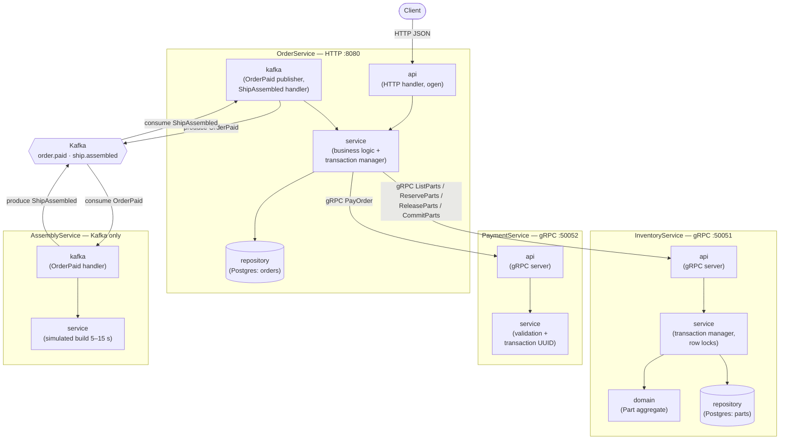
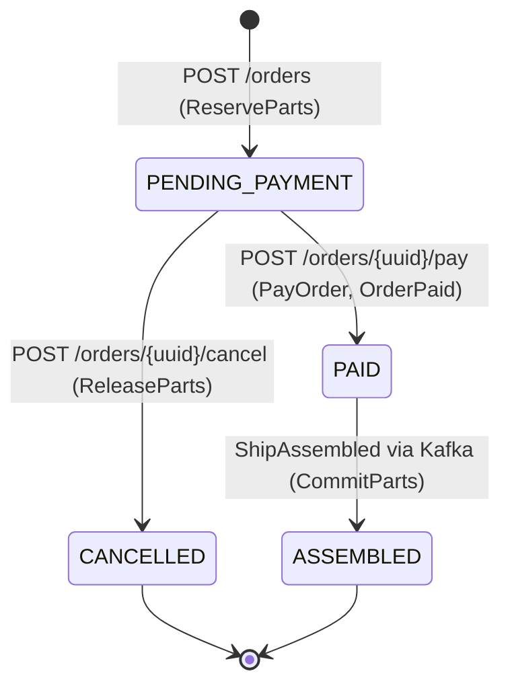
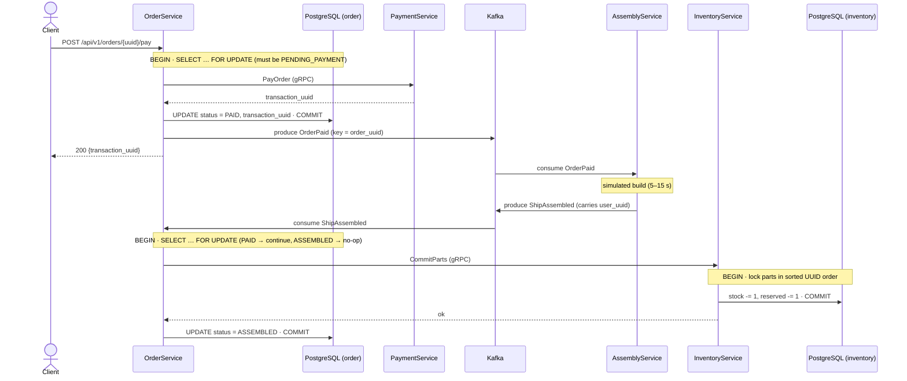
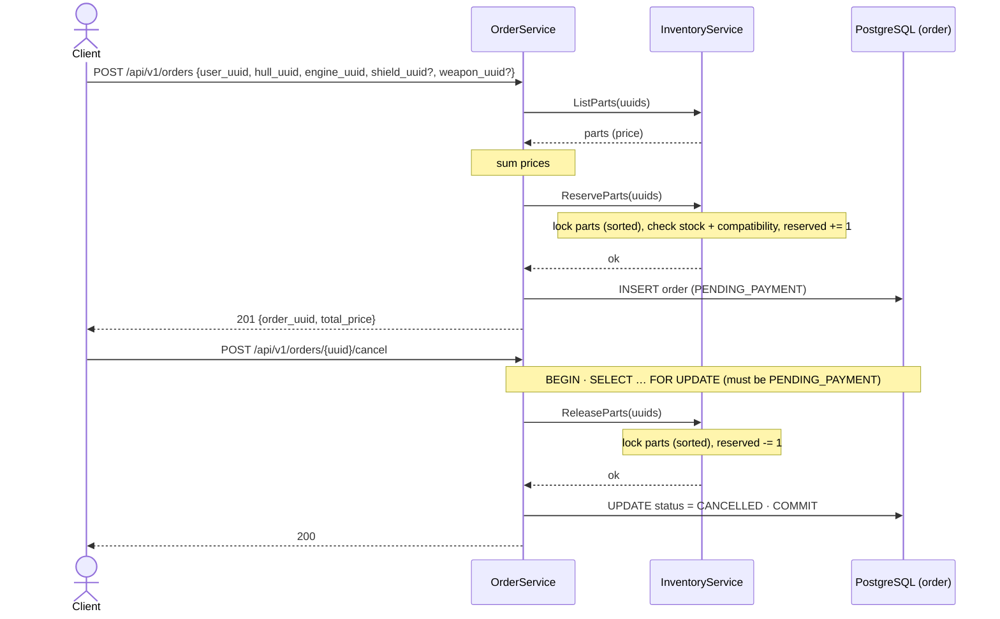
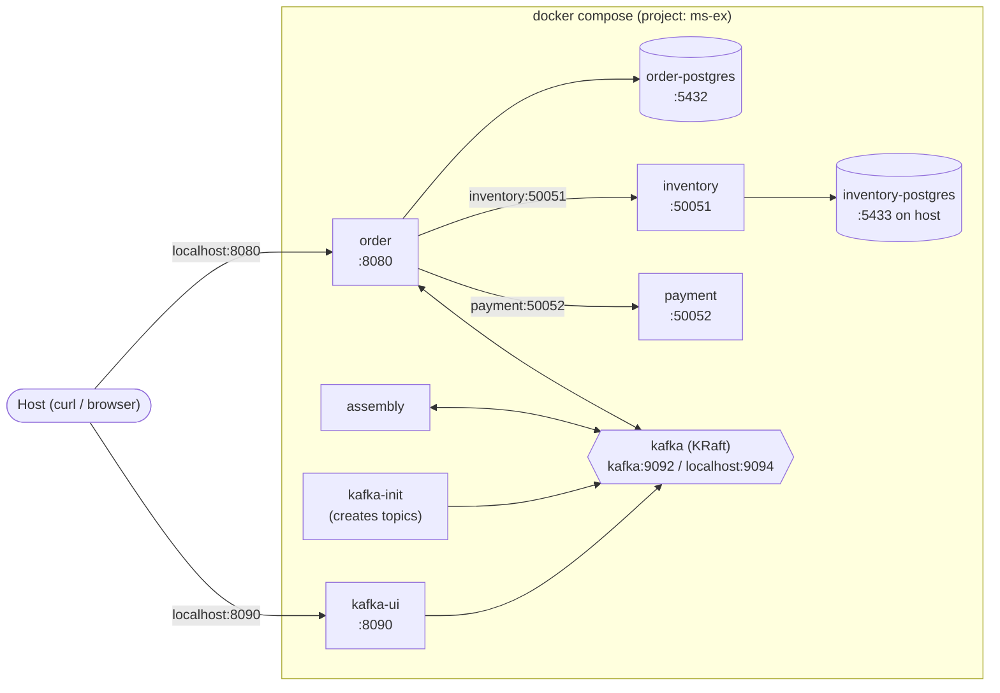

# Architecture

Four Go services build a toy "order a spaceship" system:

- **OrderService** — HTTP API (`:8080`), the only service a client talks to
  directly. Owns orders (PostgreSQL). Kafka producer of `OrderPaid`, consumer
  of `ShipAssembled`.
- **InventoryService** — gRPC (`:50051`), owns the parts catalog, stock and
  reservations (PostgreSQL).
- **PaymentService** — gRPC (`:50052`), processes payments (stateless).
- **AssemblyService** — no inbound port; Kafka consumer of `OrderPaid`,
  simulates building the ship (5–15 s) and produces `ShipAssembled` (stateless).

Contracts and shared plumbing live in the `shared` module: protobuf
(`shared/proto` → `shared/pkg/proto`), the Order OpenAPI spec
(`shared/api/order/v1` → `shared/pkg/openapi`, ogen), and the sarama wrapper
`shared/pkg/kafka`.

Each service follows the same layering (`<service>/pkg/...`):

- `api` — transport adapter (HTTP handler / gRPC server). Converts wire types
  ⇄ service/domain types, maps errors to status codes.
- `kafka` (Order, Assembly) — the async counterpart of `api`: decodes events,
  calls the service, encodes outgoing events.
- `service` — business logic. Depends only on narrow interfaces it declares
  itself (`Repository`, `InventoryClient`, `TrManager`, `OrderPaidPublisher`,
  …), never on transport or Kafka types.
- `domain` (Inventory) — the `Part` aggregate guards stock/reservation
  invariants (`Reserve`, `Release`, `Commit`).
- `repository` — storage. Order and Inventory have a **PostgreSQL**
  implementation (used in `cmd/main.go` and the Compose stack) and an
  in-memory one used only by the self-contained API test suite (`order/tests`).

`internal/app` in each service is the only place that reads env vars and
builds concrete types.

## Component overview

`OrderService.service` is the orchestrator: it is the only place that calls
the other services synchronously, and it reacts to the asynchronous
`ShipAssembled` event. AssemblyService knows nothing about orders beyond the
event payload.

## Order lifecycle

Pay and Cancel are only allowed from `PENDING_PAYMENT`. Otherwise the order is
left unchanged and the service returns `ErrOrderAlreadyPaid`,
`ErrOrderCancelled` or `ErrOrderAssembled` (HTTP 409 with that message).

Inventory's view of the same lifecycle, per part:

| Order step | `reserved` | `stock_quantity` |
|---|---|---|
| create (`ReserveParts`) | +1 | — |
| cancel (`ReleaseParts`) | −1 | — |
| assembled (`CommitParts`) | −1 | −1 |

## Event flow: pay → assemble

### Events

Defined in `shared/proto/events/v1/events.proto`, sent as protobuf bytes,
keyed by `order_uuid` (one order's events stay ordered on one partition).
Topics are created up front by the `kafka-init` Compose service (3 partitions
each); constants live in `shared/pkg/kafka`.

| Topic | Message | Producer → Consumer (group) | Fields |
|---|---|---|---|
| `order.paid` | `OrderPaid` | Order → Assembly (`assembly-service`) | `event_uuid`, `order_uuid`, `user_uuid`, `payment_method`, `transaction_uuid` |
| `ship.assembled` | `ShipAssembled` | Assembly → Order (`order-service`) | `event_uuid`, `order_uuid`, `user_uuid`, `build_time_sec` |

### Delivery semantics

- **At-least-once.** The consumer marks an offset only after the handler
  returns nil; a returned error makes the session rejoin (1 s backoff) and the
  message is redelivered. Offsets are auto-committed by sarama every second,
  so a crash can also cause redelivery.
- **Idempotent handlers.** `MarkAssembled` is a no-op for an order that is
  already `ASSEMBLED`; an unknown order or one in the wrong status is logged
  and skipped.
- **Poison messages** (undecodable payload, malformed UUID) are logged and
  dropped (`sharedkafka.DropMalformed`) so they can't block a partition.
- Messages are handled **one at a time per partition**; partitions are
  consumed concurrently. Assembly's 5–15 s build blocks its partition, so it
  scales by adding partitions and replicas to the consumer group.
- `OrderPaid` is published **after** the payment transaction commits. A
  publish failure is logged, not returned to the client (the payment already
  happened).

## Create and cancel

## Transactions and concurrency

Order and Inventory both use
[go-transaction-manager](https://github.com/avito-tech/go-transaction-manager)
(pgx v5 driver). Services wrap each read-modify-write in
`trManager.Do(ctx, fn)`; repositories pick up the active transaction (or the
plain pool) from `ctx` via `trmpgx.DefaultCtxGetter`, so they don't know
whether they're inside one. Tests and the in-memory wiring use a no-op
`TrManager`.

Concurrent requests are serialized with row locks (`SELECT … FOR UPDATE`):

- **Order** — `PayOrder`, `CancelOrder` and `MarkAssembled` read the order with
  `GetForUpdate`, so double-pay, pay-vs-cancel and duplicate `ShipAssembled`
  can't interleave. The lock is held across the gRPC call to Payment/Inventory.
- **Inventory** — `ReserveParts`, `ReleaseParts` and `CommitParts` lock every
  affected part with `GetPartForUpdate` inside one transaction. Part UUIDs are
  **sorted before locking**, so two requests for overlapping parts always lock
  in the same order and can't deadlock.

## Deployment

`deploy/compose/docker-compose.yaml` is the single Compose file for the whole
stack — one project (`ms-ex`), one default network, every service reachable by
container name:

- `task up` / `task stop` / `task down` — build+start, stop (keep
  containers/volumes), or stop+remove (including volumes) the whole stack.
  Order and Assembly start only after `kafka-init` has created the topics.
- App containers get `DB_URI` / `KAFKA_BROKERS` pointed at in-network
  hostnames; the host-side `DB_URI` in `order.env` / `inventory.env` is for
  `goose` running on the host. Host-run services (`task run:*`) use Kafka at
  `localhost:9094`.
- `task migrate:order:up` / `task migrate:inventory:up` (and `:down` /
  `:status`) — goose migrations. Inventory's first migration seeds the parts
  catalog. Order's `user_uuid` was added via expand → backfill → contract
  (`00002`–`00004`).
- Kafka UI on http://localhost:8090 shows topics, messages and consumer-group lag.
- `task test:e2e` (`scripts/e2e_test.sh`) drives this exact stack: `task up` →
  migrate → HTTP scenarios and error cases → waits for the Kafka chain to bring
  an order to `ASSEMBLED` → checks stock in Postgres → restarts `order` to
  prove persistence → `task down`.

## Error mapping

Business-rule failures are plain sentinel errors in `service`/`domain`; the
`api` layer is the only place that knows about HTTP/gRPC status codes and
maps them with `errors.Is`. Repository "not found" is a plain sentinel
(`repository.ErrNotFound`) that `service` translates into its own error.

| Error | Order HTTP | Inventory gRPC |
|---|---|---|
| order / component / part not found | 404 | `NotFound` |
| invalid input (missing field, malformed UUID, bad enum) | 400 (ogen validation) | `InvalidArgument` |
| order already paid / cancelled / assembled | 409 | — |
| component out of stock, incompatible components | 409 | `FailedPrecondition` (`ErrInsufficientStock`, `ErrIncompatibleParts`) |
| release/commit more than reserved | — | `FailedPrecondition` (`ErrReservationUnderflow`) |
| anything else | 500 | `Internal` |

Kafka handlers have their own policy: malformed → drop, transient error →
return (redelivery), business "can't apply" → log and skip.

## Known limitations

- **No transactional outbox.** A crash between the payment commit and the
  `OrderPaid` publish loses the event; the order stays `PAID`.
- **No saga/compensation across services.** E.g. if Inventory `ReserveParts`
  succeeds but the order insert fails, the reservation isn't released.
- **Row lock held across gRPC calls** in Order's Pay/Cancel/MarkAssembled —
  acceptable at this scale, would need rethinking under load.
